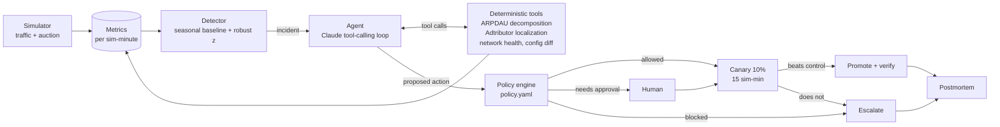

# Floorwalker

**An AI agent on call for a mobile game's ad revenue.** It watches a hybrid mediation stack,
detects revenue incidents, finds the root cause with deterministic tools, and ships fixes
through policy guardrails and a canary. Click "Break something" and watch it work.

Runs on your own machine in a few minutes: see [Run it locally](#run-it-locally). There is no hosted
demo. Evals: [EVALS.md](EVALS.md)

<!-- TODO: add a 30-60 s GIF of one incident here -->

> **Simulated environment.** Traffic, bids and the six ad networks (Network A-F) are synthetic
> and fictional. What is real: the auction logic, the detection and root-cause maths, the
> guardrails, the agent loop and the evals.

## What it does

| Ad-monetization job | How Floorwalker does it |
|---|---|
| Ad networks | Hybrid mediation: 3 in-app bidders (first-price) + 3 waterfall lines with floors, 5 geos x 3 formats |
| Ad pricing | Versioned floor config; the agent can step floors within policy limits |
| Revenue monitoring | 255 series checked every sim-minute against a seasonal baseline (robust z-score) |
| Automatic fixes | Agent proposes rollback / floor change / network disable / escalation; policy check, 10% canary, auto-revert |

## Design: the LLM never does the maths



- **Detection** (`detection.py`): actual vs "same time yesterday" over a 5-minute window; an incident
  opens after 3 consecutive breaches of z < -5.
- **Which lever moved** (`rca.py`): exact log decomposition
  `dlog(rev/DAU) = dlog(requests/DAU) + dlog(fill) + dlog(show rate) + dlog(eCPM)`.
- **Where** (`rca.py`): Adtributor-style explanatory power and surprise across network, geo and format
  (Bhagwan et al., NSDI 2014).
- **Agent** (`agent/llm.py`): Claude decides which tool to call next and what to conclude. If there is no
  API key, or a call fails, a rule-based runbook (`agent/fallback.py`) takes over.
- **Guardrails** (`policy.yaml`, `policy.py`): floor moves capped at 15% per step, 3 changes per sim-hour,
  rollbacks limited to recent changes, human approval to disable a network earning over 30% of a geo,
  kill switch. Every check is recorded on the incident timeline.
- **Canary** (`simulator.py`, `agent/runner.py`): every fix serves 10% of affected traffic for 15 sim-minutes
  and is promoted only if revenue per request beats control.
- **Observability**: full agent timeline per incident in the UI, config audit log with diffs, optional
  Langfuse traces.

## Incidents you can inject

| Fault | Kind | Right answer |
|---|---|---|
| Bad floor push | bad config push | roll back |
| Bidder timeout misconfigured | bad config push | roll back |
| Network latency spike | external | disable the slow network in that geo (approval if it is a big earner) |
| Demand drop | external | waterfall line: step the floor down and let the canary decide; bidder: escalate |
| Traffic drop | external | escalate; the ad stack is healthy |

Escalating is a correct outcome, not a failure: an agent that changes config when it should not is worse
than one that hands over the evidence.

## Run it locally

You need Python 3.10 or newer, Node 20 or newer, and `make`. An Anthropic API key is optional.

### 1. Install

```bash
git clone https://github.com/Yuvraj-Singh-Shehrawat/floorwalker.git
cd floorwalker
make setup
```

`make setup` creates a virtualenv in `backend/.venv`, installs the Python and Node dependencies, and
creates `backend/.env` and `web/.env.local` from the example files. It picks the newest
`python3.10`-`python3.13` on your PATH. To choose one yourself: `make setup PY=python3.12`.

### 2. Choose the agent mode (optional)

- **No key:** do nothing. The agent runs as a rule-based runbook and the whole demo still works.
- **LLM agent:** open `backend/.env` and fill in `ANTHROPIC_API_KEY=`. Each incident then costs 3-5 calls
  to `claude-haiku-5-5`. To use another model, set `FLOORWALKER_MODEL` in the same file.

### 3. Start it

```bash
make dev
```

This starts the API on http://localhost:8000 and the dashboard on http://localhost:3000. Ctrl-C stops
both. The first start is slower while the simulator learns its baseline; later starts use a cache.

### 4. Break something

1. Open **http://localhost:3000**. The header shows `Agent: LLM · <model>` or
   `Agent: rule-based runbook (no API key)`.
2. In the "Break something" card pick **Bad floor push**, geo **US**, and click **Break it**.
3. Within about 30 seconds the revenue chart dips, an incident opens, the agent's tool calls and
   conclusion appear on the timeline, a canary runs, and revenue recovers.
4. Try the other four faults. A latency spike on a big network pauses for your **Approve / Reject**.
   Only one incident runs at a time, and the environment resets within a minute of each one closing.

One simulated minute passes per real second.

### Other commands

```bash
make test        # 22 tests, no API key or network needed
make eval        # incident benchmark with the rule-based runbook; overwrites EVALS.md
make eval-llm    # same benchmark with the LLM agent (needs the key, about 90 LLM calls); overwrites EVALS.md
make backend     # API only
make web         # dashboard only
```

### Without `make`

```bash
# terminal 1: API
cd backend
python3.12 -m venv .venv && .venv/bin/pip install -r requirements.txt
export ANTHROPIC_API_KEY=...        # optional; the server does not read backend/.env by itself
.venv/bin/uvicorn app.main:app --port 8000

# terminal 2: dashboard
cd web
npm install && npm run dev
```

### If something looks wrong

- **`TypeError: Unable to evaluate type annotation 'str | None'`**: the virtualenv was built with Python 3.9
  (the macOS default). Run `make setup PY=python3.12`.
- **http://localhost:8000 shows JSON, not a dashboard**: that port is the API. The dashboard is on port 3000.
- **Dashboard says "Cannot reach the backend"**: check that `make dev` is still running and that
  http://localhost:8000/healthz returns `{"ok":true,...}`.
- **Timeline shows "LLM call failed"**: the step shows the error text. A rejected model id is fixed by
  setting `FLOORWALKER_MODEL` in `backend/.env`; the runbook takes over for that incident either way.
- **"Break it" is refused**: an incident is still in progress or the environment is resetting; wait a few
  seconds. There is also a limit of 10 injected faults per hour (`CHAOS_MAX_PER_HOUR`).

## Hosting it (optional)

Nothing here needs hosting. If you want to, `backend/` has a Dockerfile for any container host; set
`ANTHROPIC_API_KEY`, `ADMIN_TOKEN` and `CORS_ORIGINS`, and run exactly one always-on instance, because
the simulator lives in process memory. The dashboard is a standard Next.js app in `web/`; set
`NEXT_PUBLIC_API_URL` to the backend URL.

## Results

LLM agent (`claude-haiku-5-5`), 25 injected incidents (5 types x 5 seeds) and 20 clean runs, generated by
`make eval-llm` on 2026-11-10. All demand is simulated; times are sim-minutes.

| Metric | Floorwalker | Static alert (geo revenue -20% vs trailing hour) |
|---|---|---|
| Incidents detected | 100% | 76% |
| Median time to detect | 3 min | 6 min (when it fires) |
| False alarms in 80 clean sim-hours | 0 | 0 alerting minutes |
| Root cause correct | 100% | n/a (alerts do not diagnose) |
| Action appropriate | 92% | n/a |
| Median time to fix live (when a fix is promoted) | 20 min | n/a |

The two "action" misses are both demand drops on a waterfall line: the agent found the right cause but
escalated instead of stepping the floor down. The per-incident breakdown is in [EVALS.md](EVALS.md), which
also states which agent mode produced the numbers; only LLM-mode numbers say anything about the agent.
These are the same five incident types the agent was developed against, not a held-out set.

## Limitations

- Demand is synthetic; bid distributions are hand-parameterised lognormals, not fitted to real logs.
- The five incident types are single-fault and abrupt. Compound and slow-burn incidents are not covered yet.
- Canary promotion uses a fixed margin, not a sequential significance test.
- State is in memory; the demo environment resets itself 30 sim-minutes after each incident.

## Roadmap

Sequential-test canaries, a held-out compound-incident eval set, a Thompson-sampling floor optimizer
benchmarked against static floors, Postgres persistence, and bid distributions calibrated on public RTB logs.
